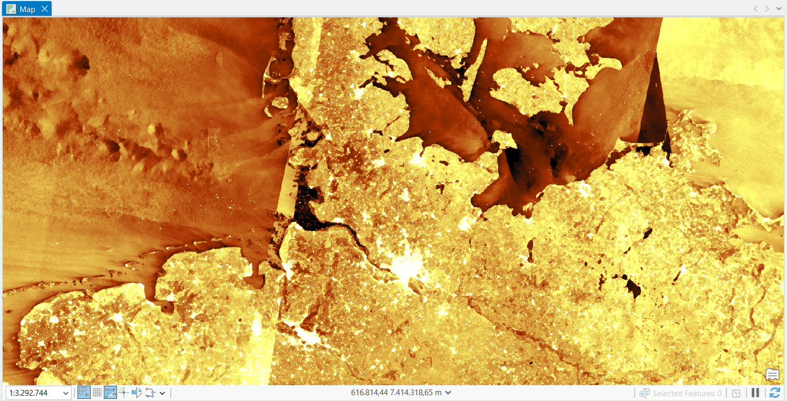
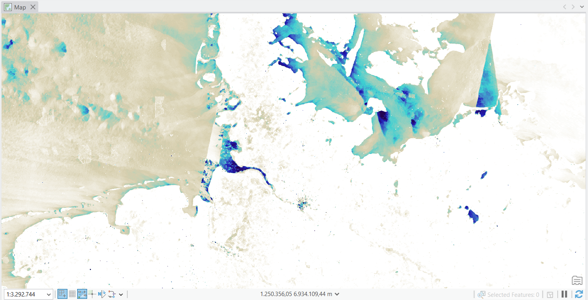
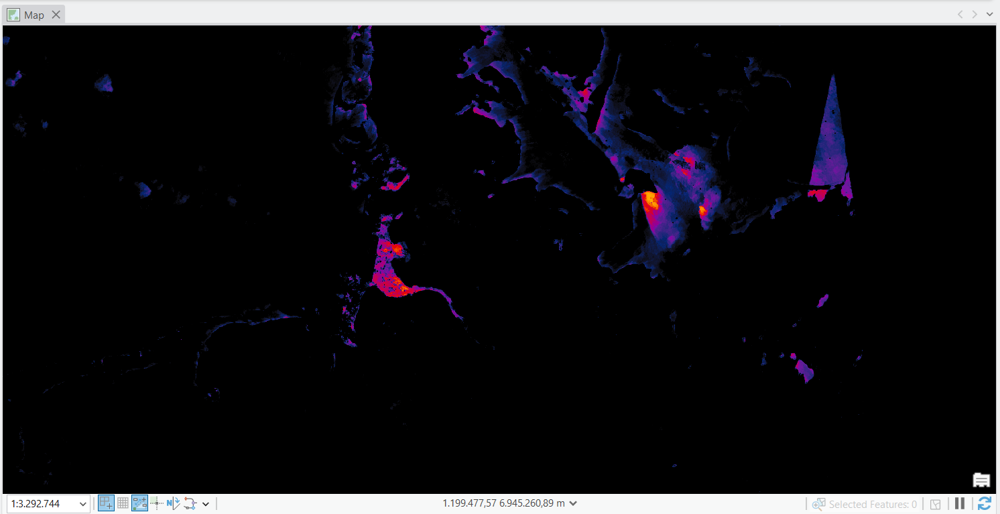
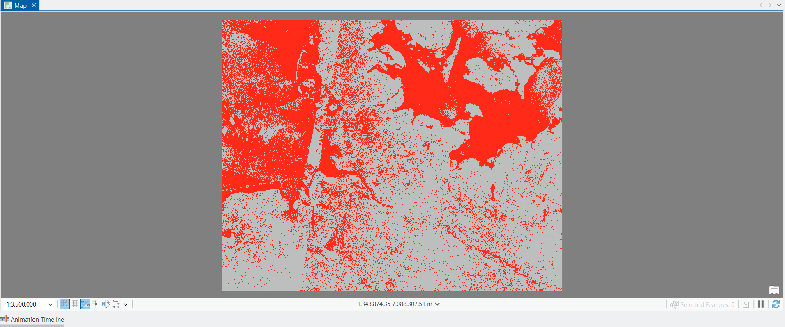
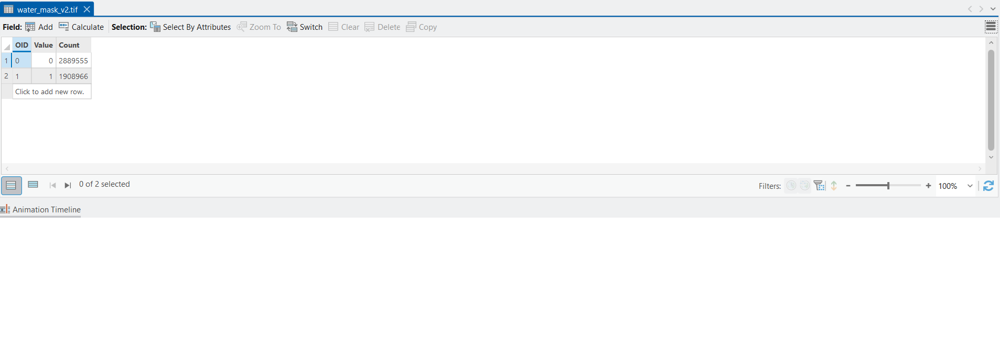

# Sentinel-1 SAR Water Monitoring – North Sea & Baltic Sea
**English | [Deutsch](#deutsch)**

## Overview
Water detection with Sentinel-1 SAR (RTC) imagery over the North Sea and Baltic Sea around Schleswig-Holstein, built from scratch in **ArcGIS Pro** using the Esri **ArcGIS Living Atlas**. Radar works day and night and through clouds, which makes it well suited to monitoring water surfaces.

Part of my portfolio built on the Esri course *The ArcGIS Imagery MOOC: Foundations and Frontiers*.

## Workflow
1. Added the **Sentinel-1 RTC** imagery layer (VV, VH, VV-VH) from the Living Atlas to a new ArcGIS Pro map.
2. Compared Living Atlas **processing templates**: VV dB, Surface Water Index (SWI) and Water Anomaly Index.
3. Extracted the **VV band** with the *Extract Bands* raster function (non-DRA False Color dB, so values stay comparable across the scene).
4. Built a **water mask** with the *Remap* raster function: VV < -1.25 (about -12.5 dB) = water (1), otherwise 0.
5. Exported the 250 m mask and ran *Build Raster Attribute Table* to count pixels in ArcGIS.
6. Converted pixel counts to km² (Python, with Web Mercator area correction) and checked the result against a land/sea reference.

## Results
| Class | Pixels (ArcGIS attribute table) |
|---|---|
| 0 – no water | 2,889,555 |
| 1 – water | 1,908,966 |

| Region | Reference sea area (km²) | Detected water (km²) | Detection rate |
|---|---|---|---|
| North Sea (lon < 8.9°E) | 19,513 | 15,152 | 77.7 % |
| Baltic Sea (lon > 9.7°E) | 15,306 | 13,311 | 87.0 % |

Land false positives: 11,416 km² (16.8 %). Full table: [water_area_results.csv](water_area_results.csv)

## Images

## Limitations
- One fixed threshold for the whole scene: wind-roughened sea (mostly North Sea) reflects more radar and is partly missed.
- Dark land surfaces (wet fields, shadowed areas, some forest) are partly classified as water.
- The Water Anomaly Index highlights candidate pixels (turbidity, sediment, wind effects). It does **not** prove pollution.
- Pixel counts come from ArcGIS. The km² values were computed in Python from the exported 250 m raster, with a correction for Web Mercator area distortion.

## Tools
ArcGIS Pro · Sentinel-1 RTC · ArcGIS Living Atlas · Raster Functions (Extract Bands, Remap) · Python (NumPy, SciPy)

---

# Sentinel-1-SAR-Wasserüberwachung – Nord- und Ostsee
**[English](#english) | Deutsch**

## Überblick
Wassererkennung mit Sentinel-1-SAR-Daten (RTC) über Nord- und Ostsee im Raum Schleswig-Holstein, komplett neu aufgebaut in **ArcGIS Pro** mit dem Esri **ArcGIS Living Atlas**. Radar funktioniert bei Tag und Nacht und durch Wolken hindurch und eignet sich deshalb gut zur Überwachung von Wasserflächen.

Teil meines Portfolios zum Esri-Kurs *The ArcGIS Imagery MOOC: Foundations and Frontiers*.

## Vorgehen
1. **Sentinel-1-RTC**-Bildlayer (VV, VH, VV-VH) aus dem Living Atlas in eine neue ArcGIS-Pro-Karte geladen.
2. **Verarbeitungsvorlagen** des Living Atlas verglichen: VV dB, Surface Water Index (SWI) und Water Anomaly Index.
3. **VV-Band** mit der Raster-Funktion *Extract Bands* extrahiert (False Color dB ohne DRA, damit die Werte über die ganze Szene vergleichbar bleiben).
4. **Wassermaske** mit der Raster-Funktion *Remap* erstellt: VV < -1,25 (ca. -12,5 dB) = Wasser (1), sonst 0.
5. Maske mit 250 m Zellgröße exportiert und mit *Build Raster Attribute Table* die Pixel in ArcGIS gezählt.
6. Pixelzahlen in km² umgerechnet (Python, mit Flächenkorrektur für Web Mercator) und mit einer Land-/Meer-Referenz verglichen.

## Ergebnisse
| Klasse | Pixel (ArcGIS-Attributtabelle) |
|---|---|
| 0 – kein Wasser | 2.889.555 |
| 1 – Wasser | 1.908.966 |

| Region | Referenz-Meeresfläche (km²) | Erkannte Wasserfläche (km²) | Erkennungsrate |
|---|---|---|---|
| Nordsee (Länge < 8,9°E) | 19.513 | 15.152 | 77,7 % |
| Ostsee (Länge > 9,7°E) | 15.306 | 13.311 | 87,0 % |

Falsch-positive Landflächen: 11.416 km² (16,8 %). Vollständige Tabelle: [water_area_results.csv](water_area_results.csv)

## Bilder
Siehe Abschnitt „Images“ oben.

## Einschränkungen
- Ein fester Schwellenwert für die ganze Szene: windaufgerautes Meer (vor allem Nordsee) wird teilweise nicht erkannt.
- Dunkle Landflächen (nasse Felder, Schatten, teils Wald) werden teilweise als Wasser eingestuft.
- Der Water Anomaly Index zeigt nur Kandidatenpixel (Trübung, Sediment, Windeffekte) und **keinen Nachweis von Verschmutzung**.
- Die Pixelzahlen stammen aus ArcGIS. Die km²-Werte wurden in Python aus dem exportierten 250-m-Raster berechnet, mit Korrektur der Flächenverzerrung von Web Mercator.

## Werkzeuge
ArcGIS Pro · Sentinel-1 RTC · ArcGIS Living Atlas · Raster-Funktionen (Extract Bands, Remap) · Python (NumPy, SciPy)
